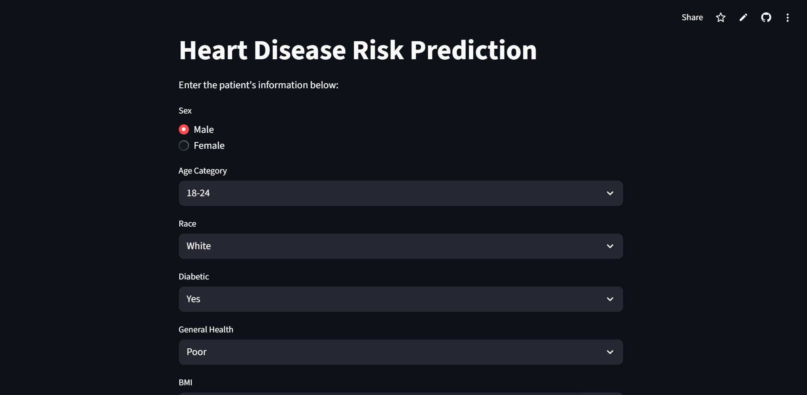
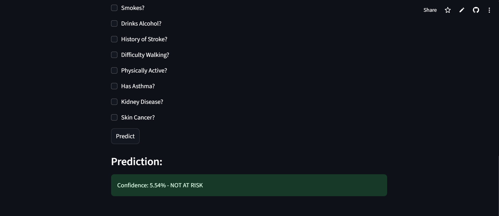
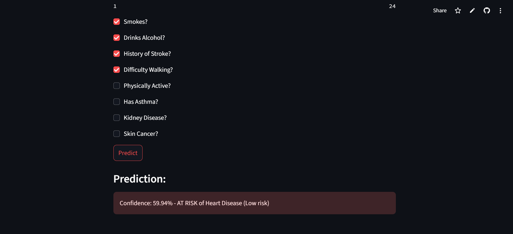
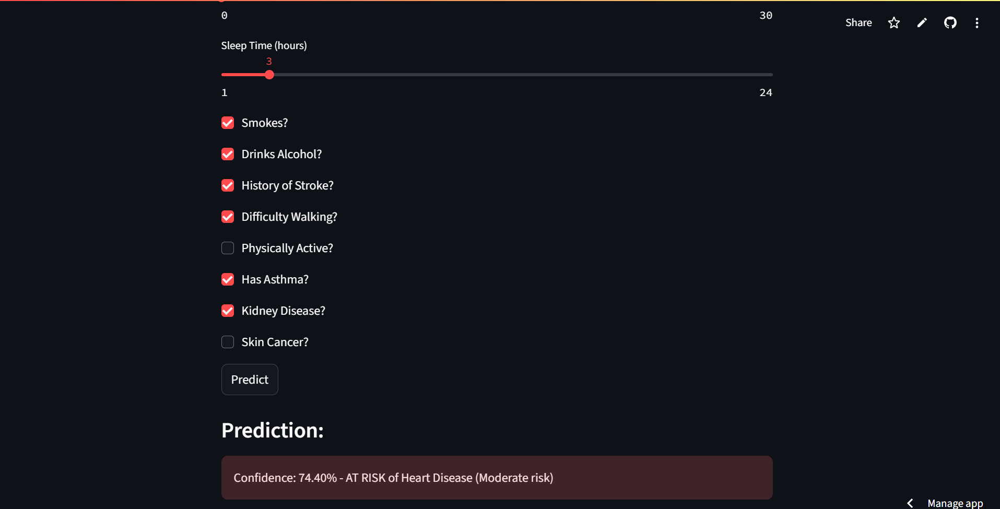
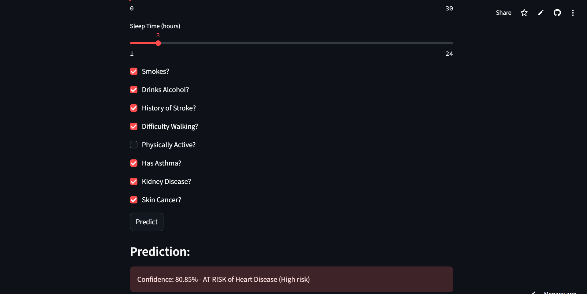

# HEART DISEASE RISK PREDICTOR WEB APP

## 📄 App Description

This app is a simple heart disease risk predictor. It uses a LightGBM machine learning model trained on the heart disease 2020 dataset from Kaggle. Users can input given patient information, and the app will predict whether the individual is at risk or not and display the confidence score of the result in real-time.

## ⚙️ Setup Instructions

1. Clone or Download the App

2. Install Required Libraries

    Run the following command in your terminal:

        pip install -r requirements.txt

3. Train the Model

    This step creates the model.joblib and preprocessing.joblib files in the models/ directory.
    Training uses stratified cross-validation to tune LightGBM hyperparameters using PR-AUC,
    random undersampling of the majority class, and gain-based feature selection that retains
    input features covering 95% of total importance.Preprocessing and undersampling are
    fit on training data only.

        python train.py

4. Run the App

    In your terminal, navigate to the directory containing your script and run:

        streamlit run app.py

4. Interact

    A browser window will open.

    Fill out the patient information form.

    Click "Predict" to see whether the patient is at risk or not and the confidence score of the result.

## Screenshots

### UI: 

### NOT AT RISK:

### AT RISK (LOW RISK):

### AT RISK (MODERATE RISK):

### AT RISK (HIGH RISK):

